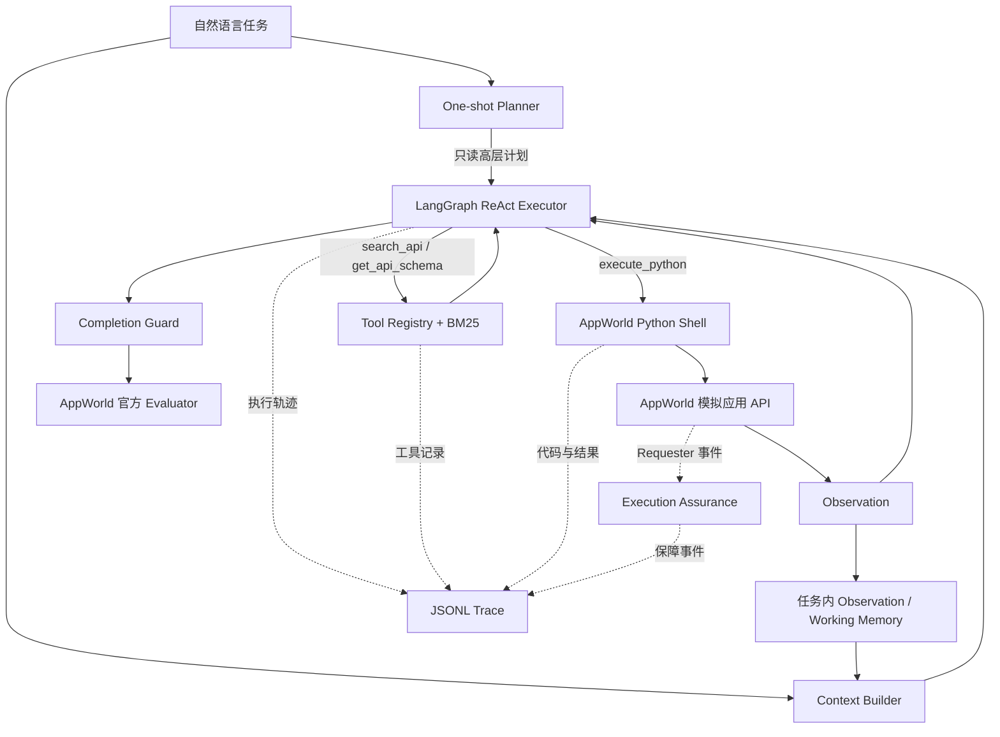

<!-- AppWorld AgentLab README | Chinese primary language -->

<div align="center">

# AppWorld AgentLab

### 用可追踪、可评测的 ReAct Agent 完成 AppWorld 任务

一次性任务规划 · Function Calling · AppWorld Python Shell · 上下文工程 · 执行保障


**这是一个以 Agent 系统工程和学习实践为目标的个人项目。**
AppWorld 提供可交互的模拟应用与官方评测；AgentLab 负责规划、工具调用、上下文管理、执行记录和恢复保护。

</div>

---

## 项目概览

AppWorld 任务通常需要 Agent 跨多轮调用应用 API、处理真实反馈，并在完成后通过官方 Evaluator。这个项目围绕这条执行链构建了一个可检查的 Plan-Guided ReAct Runtime：

- Planner 只在任务开始时生成一次高层计划；计划是参考，不直接执行业务操作。
- ReAct Executor 通过标准工具调用选择 API 检索、Schema 查询或 Python 执行。
- Python 代码在同一个 AppWorld Shell 中执行，环境状态跨步骤保留。
- Context Builder 组织最近历史、记忆和任务进度。
- Execution Assurance 记录执行事件，并提供 Action/Outcome Gate、局部错误恢复和提交检查。
- Trace 与 AppWorld 官方评分一起保存，便于复现和失败诊断。

### 最近一次固定 Train-15 复测

| 指标 | 本次结果 |
|---|---:|
| 完整任务通过 | **8 / 15（53.3%）** |
| 官方断言通过 | **66 / 78（84.6%）** |
| Executor 步数 | 559 |
| LLM 请求 | 574 |
| 输入 / 缓存命中 / 输出 Token | 4,038,206 / 49,408 / 31,480 |

这是一次小规模 Train 开发集复测，不代表完整 AppWorld Benchmark 性能。上一次运行完整通过 9/15、断言也是 66/78；同一批任务出现了逐题波动，因此这里不宣称稳定提升。两次 SIWC 传输中断的任务各重跑一次后才得到完整评分，原始运行和重跑 Trace 均保留。

逐题结果保存在本机 `reports/` 和独立运行目录中；Trace 与数据类运行产物默认不纳入 Git。

---

## 架构



执行主循环保持简单：**LLM 选择工具 → 本地校验与分派 → AppWorld 执行 → Observation 回灌 → 下一轮 ReAct**。Planner 不替代 Executor，Assurance 也不负责日常业务规划。

---

## 主要能力

| 模块 | 作用 |
|---|---|
| **Plan-Guided ReAct** | 一次性生成高层计划，之后由 ReAct 根据工具反馈自主执行 |
| **Function Calling** | 结构化分派 `search_api`、`get_api_schema`、`execute_python` |
| **Schema-Aware Retrieval** | 使用 BM25 搜索 AppWorld 官方 API 文档，必要时回查完整 Schema |
| **Programmatic Execution** | 在一次 Python 执行中组合确定的查询、分页、筛选和数据处理 |
| **Context Engineering** | 支持 full、dynamic、unified 上下文组织，以及任务内记忆和轨迹压缩 |
| **Execution Assurance** | 记录 Requester 事件，提供安全边界、局部错误恢复和 Completion Guard |
| **SIWC Model Adapter** | 通过官方 Sign in with ChatGPT OAuth 调用 Responses API，不使用普通 API Key |
| **可复现 Trace** | 保存有效配置、请求用量、工具结果、终止原因和官方评测报告 |

---

## 目录结构

```text
.
├── configs/                  # 固定 Train-15 与批次运行配置
├── docs/                     # SIWC 手动授权说明
├── experiments/              # 固定 Train-15 批次运行入口
├── scripts/                  # 单任务运行、SIWC 登录与 Smoke 脚本
├── src/agentlab/
│   ├── agent/                # Planner、Prompt、ReAct Graph
│   ├── context_engineering/  # Dynamic / Unified Context、Compaction
│   ├── memory/               # Observation Store、Working Memory
│   ├── tool_engineering/     # BM25 API 检索、Schema、Tool Registry
│   ├── execution_assurance/  # Gates、Goal Tracker、恢复、提交保护
│   ├── models/               # SIWC OAuth 与 Responses Adapter
│   ├── environments/         # AppWorld 执行接口
│   ├── runtime/              # 任务状态与 Trace
│   └── evaluation/           # 官方评测报告解析
└── tests/                    # 离线与 Mock 测试
```

本地 `vendor/`、任务数据、`runs/`、`run_records/`、凭据和历史报告不会提交到仓库。

---

## 环境准备

当前开发环境为 **Windows + Conda `agent` + Python 3.11.18**。开发时使用 LangGraph 1.2.24、Requests 2.34.2、PyJWT 2.15.1；AppWorld 源码和允许使用的任务数据需要单独安装，不包含在本仓库中。

### 1. 安装项目与 AppWorld

克隆 AgentLab：

```powershell
git clone https://github.com/ushio-ushio/AppWorldAgent.git
cd AppWorldAgent
conda create -n agent python=3.11 -y
conda activate agent
```

安装 AgentLab 运行依赖，并按 [AppWorld 官方仓库](https://github.com/StonyBrookNLP/appworld) 的说明获取 AppWorld、安装依赖和准备允许使用的数据：

```powershell
python -m pip install "langgraph==1.2.24" "requests==2.34.2" "PyJWT[crypto]==2.15.1" pytest
git clone https://github.com/StonyBrookNLP/appworld.git vendor/appworld
python -m pip install -e vendor/appworld
appworld install --repo
appworld download data
```

本机开发验证使用 AppWorld commit `42b5bcf`，并带有未纳入本仓库的 Windows 兼容改动。新环境应按官方当前说明安装，并单独验证 SQLite/路径兼容性；不要把本机修改过的 vendor 或数据复制到公开仓库。

当前本机目录约定为：

- AgentLab：`D:\\worldapp`
- AppWorld：`D:\\worldapp\\vendor\\appworld`
- 运行记录：`D:\\worldapp\\runs`

在 AgentLab 仓库根目录的 PowerShell 中设置 Python 导入路径：

```powershell
$env:APPWORLD_ROOT = Join-Path $PWD "vendor\appworld"
$env:PYTHONPATH = "$PWD\src;$env:APPWORLD_ROOT\src"
$env:PYTHONUTF8 = "1"
```

当前代码依赖已安装的 LangGraph、Requests、PyJWT，以及 AppWorld 自身依赖。不同 AppWorld 版本可能需要额外的 Windows 兼容处理；请先运行本地验证，不要把 AppWorld vendor 或数据复制进公开仓库。

### 2. SIWC 登录

```powershell
python scripts/siwc_manual_login.py
```

脚本会输出一次性授权链接。按 [手动浏览器登录说明](docs/siwc_manual_browser_login.md) 在当前已登录的浏览器标签页完成授权。凭据保存在当前 Windows 用户的 DPAPI 保护存储中；不要把授权链接、回调参数或 Token 写入日志或提交到 Git。

### 3. 离线检查

```powershell
python -m compileall -q src scripts experiments tests
python -m pytest -q
```

---

## 运行任务

> 以下命令会调用真实模型并使用 AppWorld 任务环境。SIWC 使用 ChatGPT 账号授权额度；它不是无限免费服务。请先确认当前账号可用模型和额度。

### 单个 Train 任务

```powershell
python scripts/run_siwc_agent.py `
  --task-id 6104387_1 `
  --model gpt-6-luna `
  --context-mode unified `
  --optimized-unified `
  --schema-aware-retrieval `
  --programmatic-execution `
  --plan-guided-react `
  --assurance-mode shadow `
  --max-steps 100
```

任务 ID 必须属于 AppWorld Train。脚本会保存本次有效配置、Trace 和官方评分报告；如果目标 Trace 已存在，会拒绝覆盖。

### 固定 Train-15

```powershell
python experiments/run_v3_shadow_train15.py
```

批次任务和配置位于 `configs/v3_shadow_train15.json`：每题一次、最多 100 个 Executor 步、并发 5、无任务级自动重试。脚本会建立独立运行目录，并记录批次状态。不要为了获得更好分数自动重跑失败任务；应先区分模型能力问题和 SIWC/环境中断。

### 输出位置

单任务和批次结果写到 `D:\\worldapp\\runs\\<experiment>\\<task_id>\\`，通常包含：

- `effective_config.json`：实际生效配置
- `trace.jsonl`：模型、工具、Observation 与保障事件
- `summary.json`：运行状态、步数和用量
- `evaluation_report.md`：AppWorld 官方评测结果

批次额外保存 `progress.json` 和 `batch_status.json`。Trace 可能包含模拟应用返回的数据，请在分享前审查并脱敏。

---

## 评测说明

- 15 题固定集合来自 **Train**，用于个人开发迭代，不是 AppWorld 官方 Dev/Test，也不能代表完整 Benchmark。
- 当前汇报的是官方 Evaluator 的断言通过情况；“完整任务通过”指该任务所有断言均通过。
- 模型输出具有随机性；不同运行的完整通过数可能变化。
- SIWC 的 ChatGPT 订阅用量不提供可靠的美元单价，因此项目不伪造 API 美元成本。
- Agent 执行时不读取 Ground Truth、参考解答或隐藏评测内容。

---

## 项目范围与限制

- 当前重点是清晰、可追踪的 Agent Runtime 工程实践，不以提出新算法或追求 SOTA 为目标。
- 只维护 Windows 开发路径；AppWorld 源码和任务数据需要用户自行按官方许可准备。
- 固定 Train-15 样本较小，实验结果适合做失败诊断，不适合得出普遍性能结论。
- 当前没有 Web UI、跨任务长期记忆或模型后训练流水线；这些不属于此版本的运行范围。

## 致谢

本项目使用 [AppWorld](https://github.com/StonyBrookNLP/appworld) 作为模拟应用环境和官方评测基准。相关论文：
**AppWorld: A Controllable World of Apps and People for Benchmarking Interactive Coding Agents**, ACL 2024.

---

<div align="center">

如需复现，请先准备 AppWorld 环境与数据，再使用相同配置运行 Train 任务。

</div>
