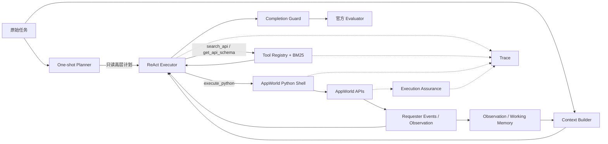

<div align="center">

# AppWorld AgentLab

### 面向交互式应用环境的可追踪 Plan-Guided ReAct Agent

**一次性任务规划 · Function Calling · 程序化执行 · 动态上下文 · 执行保障**


</div>

---

## 摘要

面向 AppWorld 的交互式任务需要 Agent 在模拟应用中发现并调用 API、处理跨步骤数据依赖、执行有副作用的操作，并以可验证的结果完成任务。此类流程的工程难点不仅是生成正确代码，还包括 API 探索成本、长程上下文管理、部分失败恢复以及任务提交可靠性。

AppWorld AgentLab 实现了一套 **Plan-Guided ReAct** 执行框架：任务开始时由 Planner 生成一次高层计划；随后由 LangGraph ReAct Executor 自主选择工具，并在持久化 AppWorld Python Shell 中完成 API 调用与程序化数据处理。BM25 API 检索、上下文组织与压缩、Requester 事件记录、局部错误恢复和 Completion Guard 为执行链提供可追踪的工程支持。任务结果由 AppWorld 官方 Evaluator 评分。

在固定的 **Train-45** 开发评测集上，使用 GPT-6 Luna、`cache_first`、`reflection_v1`、100 步上限和 5 个推理 worker 完成了一次运行：完整通过 **32/45（71.1%）**，官方断言通过 **227/250（90.8%）**。该结果用于工程迭代和失败分析，不代表官方全量 Benchmark 成绩，也不构成统计显著性结论。

---

## 研究问题与系统设计

本项目围绕一个实践问题展开：**如何让多步工具 Agent 在维持任务正确性与副作用安全的同时，降低 API 发现、上下文传递和错误恢复中的执行摩擦？**

系统将任务执行拆为一次性规划和持续 ReAct 两部分。计划提供高层目标与约束，但不指定所有 API 调用顺序；Executor 根据实时工具结果决定下一步。工具执行始终经由 AgentLab Tool Node 和 AppWorld 环境，不由模型进程直接操作任务数据。



### 关键组件

| 组件 | 设计与职责 |
|---|---|
| **One-shot Planner** | 在任务开始时生成简洁计划；计划作为参考上下文，不执行真实业务写操作。 |
| **ReAct Executor** | 通过标准工具调用完成 API 发现、代码执行、观察反馈与局部策略调整。 |
| **Tool Engineering** | 基于 AppWorld 官方 API 文档进行 BM25 检索；提供精简 Schema、分页提示、错误反馈和部分成功摘要。 |
| **AppWorld Python Shell** | 在同一任务环境中保留执行状态，支持组合查询、分页、过滤、汇总与业务操作。 |
| **Context Engineering** | 支持 `full`、`dynamic`、`unified`、`cache_first` 上下文模式，管理历史、Observation、检查点与预算。 |
| **Execution Assurance** | 记录 Requester 事件，提供错误恢复、安全边界、Reflection 与提交前检查。 |
| **SIWC Adapter** | 使用官方 Sign in with ChatGPT 授权调用 Responses API；不读取 Codex CLI 凭据，也不使用普通 API Key。 |
| **Trace 与 Evaluator** | 持久记录有效配置、模型用量、工具调用、终止原因，并调用 AppWorld 官方评测。 |

---

## 固定 Train-45 评测结果

运行配置：GPT-6 Luna、`cache_first`、`reflection_v1`、Plan-Guided ReAct、每题最多 100 步、5 个推理 worker、1 个评测 worker。45 道任务均获得官方评分。

| 评测分组 | 任务数 | 完整通过 | 官方断言通过 | 平均步数 | 输入 Token 合计 | 逐题推理耗时合计 |
|---|---:|---:|---:|---:|---:|---:|
| 原 Train-15 | 15 | 11（73.3%） | 70/78（89.7%） | 30.3 | 4,261,634 | 2,033.5 秒 |
| 新增 Train-30 | 30 | 21（70.0%） | 157/172（91.3%） | 35.3 | 10,452,680 | 4,501.4 秒 |
| **Train-45** | **45** | **32（71.1%）** | **227/250（90.8%）** | **33.6** | **14,714,314** | **6,534.9 秒** |

全批累计 1,524 次工具调用：`execute_python` 802 次、`search_api` 439 次、`get_api_schema` 126 次、`read_observation` 91 次、`search_history` 66 次。Python 执行报错 105/802 次（13.1%）。13 道未全过任务主要表现为查询答案不匹配、批量目标集合或筛选覆盖不完整，以及一道任务在 Completion Guard 收口预算耗尽。

完整逐题成绩、终止状态与失败归因见[Train-45 运行报告](reports/v3_train45_cachefirst_reflection_online_20261126.md)。报告中的“逐题推理耗时合计”是各任务 `inference_seconds` 相加，不是并行批次的实际墙上时间。

### 结果解释边界

- Train-15 与 Train-30 是固定开发集分组，不是独立的官方验证集；结果用于回归和工程诊断。
- 单次生成式模型运行存在随机性。跨版本比较应固定任务、模型、上下文模式、预算和评测流程。
- 完整任务通过率与断言通过率是不同指标：前者要求该题所有官方断言通过。
- SIWC 不提供可据此计算的统一美元单价，因此仅报告服务端返回的 Token 用量，不估算订阅费用。
- Agent 运行时不读取 Ground Truth、参考解法或隐藏评测内容。

---

## 数据集

| 集合 | 用途 | 来源 |
|---|---|---|
| **Train-15** | 快速回归 | AppWorld Train 固定子集 |
| **Train-45** | 当前主要开发评测集 | Train-15 加 30 道分层选取任务，覆盖 30 个 Scenario |
| **Train-90** | 后续阶段性综合评估 | 规划中 |
| **Dev / Test-Normal / Test-Challenge** | 独立泛化评估 | 暂未用于当前迭代 |

固定清单位于 `reports/v2_lite_train15_task_ids.txt` 与 `reports/v2_lite_train45_task_ids.txt`；Train-45 元信息见 `configs/train45.json`。任务类别与结构特征用于工程分析，不应视为 AppWorld 官方分类。

---

## 仓库结构

```text
.
├── configs/                  # 固定评测集与运行配置
├── docs/                     # SIWC 授权说明
├── experiments/              # 历史实验入口
├── reports/                  # 评测报告与固定任务清单
├── scripts/                  # 单题、批次和认证入口
├── src/
│   ├── agent/                # Planner、Prompt、ReAct
│   ├── context_engineering/  # 上下文构建与压缩
│   ├── memory/               # Observation Store 与任务内记忆
│   ├── tool_engineering/     # API 检索、Schema、Tool Registry
│   ├── execution_assurance/  # 错误恢复、Reflection、提交保护
│   ├── models/               # SIWC OAuth 与 Responses Adapter
│   ├── environments/         # AppWorld 执行接口
│   ├── runtime/              # 任务状态与 Trace
│   └── evaluation/           # 官方报告解析
└── tests/                    # 离线与 Mock 测试
```

`src/` 下的职责目录直接作为顶层 Python 包，不再额外嵌套命名空间包。AppWorld vendor、任务数据、OAuth 凭据和逐题运行 Trace 不属于仓库代码；应按 AppWorld 许可与官方文档单独准备。

---

## 环境准备

### 依赖

- Python 3.11
- LangGraph
- Requests
- PyJWT（含 cryptography 支持）
- AppWorld 官方仓库、运行依赖和允许使用的任务数据

AppWorld 的安装方式和数据准备要求可能随上游版本变化。请以 [AppWorld 官方仓库](https://github.com/StonyBrookNLP/appworld) 的说明为准，将 AppWorld 安装到 `vendor/appworld`，并在仓库根目录设置导入路径：

```powershell
python -m pip install "langgraph==1.2.24" "requests==2.34.2" "PyJWT[crypto]==2.15.1" pytest
git clone https://github.com/StonyBrookNLP/appworld.git vendor/appworld
python -m pip install -e vendor/appworld
appworld install --repo
appworld download data

$env:APPWORLD_ROOT = Join-Path $PWD "vendor\appworld"
$env:PYTHONPATH = "$PWD\src;$env:APPWORLD_ROOT\src"
$env:PYTHONUTF8 = "1"
```

### 离线检查

```powershell
python -m compileall -q src scripts experiments tests
python -m pytest -q
```

---

## 运行

SIWC 运行会调用真实模型并使用 ChatGPT 账号授权额度。先完成官方授权，核实所选模型对账户可用，再启动任务。

### 单题

```powershell
python scripts/run_siwc_agent.py `
  --task-id 6104387_1 `
  --dataset-name train `
  --model gpt-6-luna `
  --context-mode cache_first `
  --plan-guided-react `
  --assurance-mode reflection_v1 `
  --max-steps 100
```

### Train-15 快速回归

```powershell
python experiments/run_v3_shadow_train15.py
```

### Train-45 批量评测

```powershell
python scripts/run_pipeline.py `
  --task-file reports/v2_lite_train45_task_ids.txt `
  --dataset-name train `
  --model gpt-6-luna `
  --context-mode cache_first `
  --assurance-mode reflection_v1 `
  --plan-guided-react `
  --max-steps 100 `
  --inference-workers 5 `
  --eval-workers 1 `
  --experiment appworld_train45_cachefirst_reflection
```

每次运行应使用独立实验名。需要恢复中断批次时，向 Pipeline Runner 提供原运行目录：

```powershell
python scripts/run_pipeline.py --resume runs/<experiment>
```

运行结果按 `runs/<experiment>/<task_id>/` 保存，通常包括 `effective_config.json`、`trace.jsonl`、`summary.json` 和 `evaluation_report.md`。Trace 可能包含模拟应用中的个人数据，应先审查并脱敏再分享。

---

## 安全与数据边界

- 模型只负责提出结构化工具调用；工具由本地 Tool Node 和 AppWorld Python Shell 执行。
- 不将 OAuth Token、Authorization Header 或凭据写入 Trace；不要提交 `.env`、认证文件、任务数据库或原始运行产物。
- AppWorld 私有数据和隐藏评测结果不得进入模型上下文或任务决策流程。
- 付款、删除、发送等副作用操作应依据任务授权执行，并保留结果不确定时的防重放约束。

## 致谢

本项目使用 [AppWorld](https://github.com/StonyBrookNLP/appworld) 作为模拟应用环境与官方评测基准。相关论文：**AppWorld: A Controllable World of Apps and People for Benchmarking Interactive Coding Agents**, ACL 2024.
